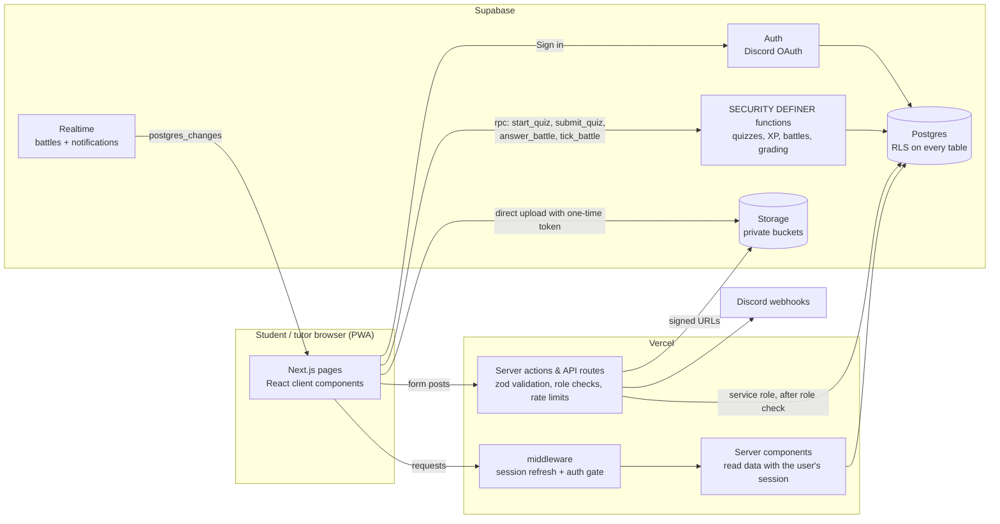

# Architecture

## Principles

* **The database is the referee.** All scoring (quiz marks, XP, multipliers, streaks, badges, quests, battle points) happens inside Postgres functions. The browser only ever sends *which option was picked*. Students have no write access to XP, scores or attempts.
* **Answers are never sent early.** Correct options live in `question_keys`, which only the tutor can read. Quiz results come back from `submit_quiz`; battle answers become visible only after `battle_reveal`.
* **Tutor tools use the service role only after `requireTutor()`** on the server. Hiding a button is never the only guard.
* **Files never pass through Vercel.** Uploads go straight to Supabase Storage with one-time signed upload URLs (avoids Vercel's 4.5 MB body limit). Downloads go through `/api/files`, which checks permission and redirects to a 2-minute signed URL.

## Anti-cheat

| Trick | Defence |
|---|---|
| Edit XP in devtools | No UPDATE grant on xp/coins/streak columns |
| Read answers from the network | Keys in a private table; options shuffled per attempt |
| Bot-speed quiz | Under 1.2 s per question → attempt flagged, no XP; tutor sees the count |
| Farm the same quiz | Retakes pay only the improvement over your best score |
| Farm speedruns / battles | XP for the first 3 speedruns and 5 battles a day only |
| Answer a battle round late | Server compares against `phase_started_at`; late answers rejected |
| Fake a level-up post | Level for Discord is read from the database, posted once per level |

## Battles

State machine in `battles`: `lobby → live → finished` (or `cancelled`). While live, each round has a `question` phase (20 s) and a `reveal` phase (5 s). Every player's browser calls `tick_battle` once a second; the first call after a timer runs out moves the battle on, so no background server is needed. Points per correct answer = 100 + up to 100 for speed. Realtime pushes changes; polling is the fallback.

## XP and levels

* XP to reach level L: `50 × L × (L − 1)` (L2 = 100, L5 = 1 000, L10 = 4 500, L20 = 19 000).
* Boost for studying above your level: `1 + 0.25 × levels jumped`.
* Days, streaks and daily/weekly quests use Mauritius time (UTC+4).

## Themes

Three CSS-variable themes (`bloxy` with light/dark, `gamer`, `retro`) in `src/app/globals.css`. Every component uses the variables, so a new theme is one CSS block plus an entry in `src/lib/brand.ts`.

## Scaling notes

Built for <20 students, but nothing here breaks at a few hundred: indexes cover the per-user queries, battles are per-room, and leaderboards are single SQL queries. The in-memory rate limiter is per server instance; swap it for Upstash Redis if this ever goes public.
